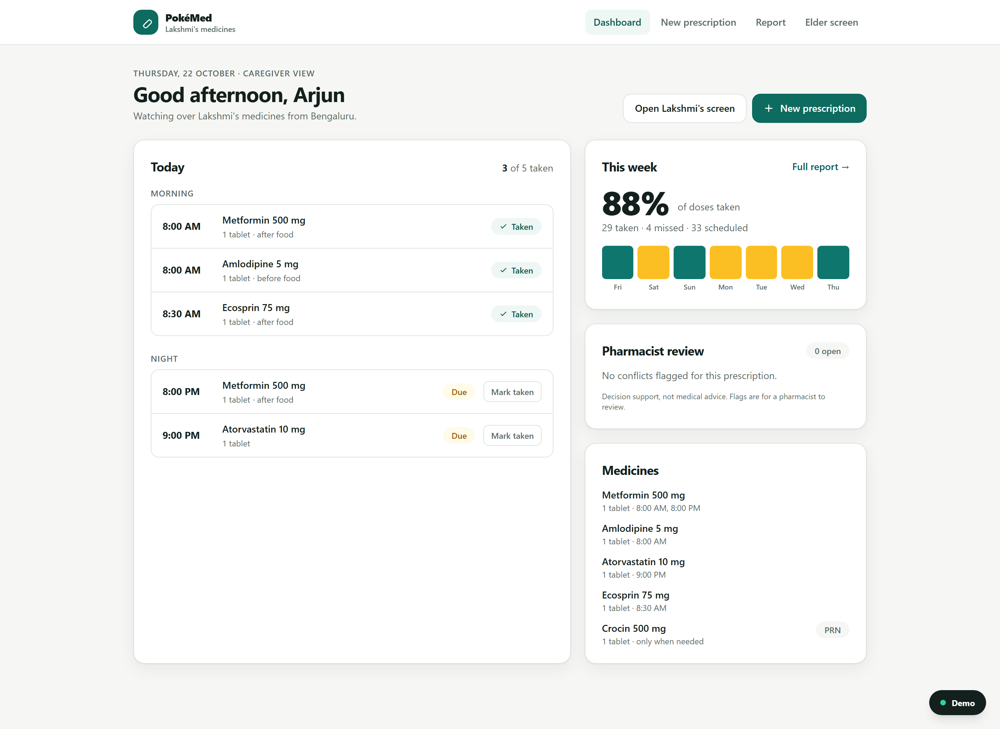
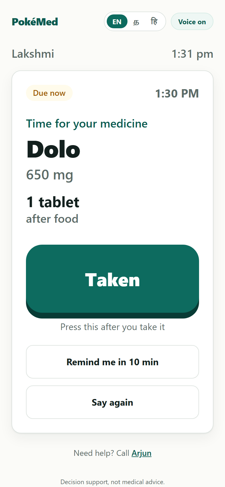
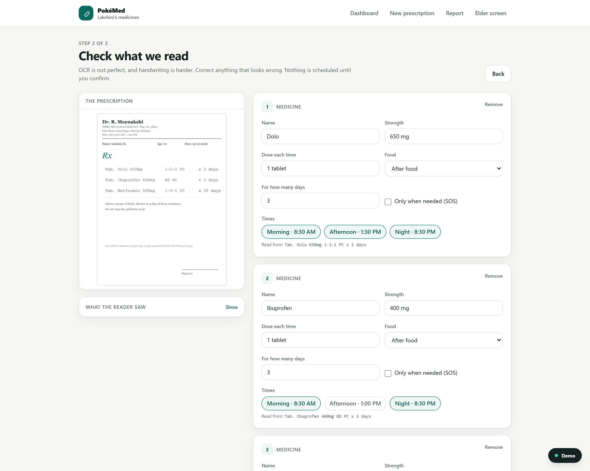
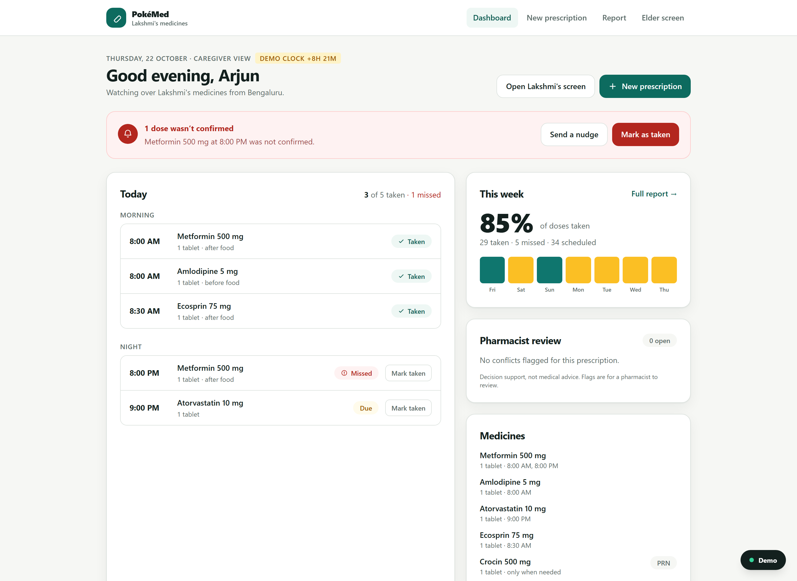

# PokéMed

**A medication companion for elderly people and their families.**

> Love shouldn't depend on a phone call asking "did you take your medicine?"

Older adults forget doses or misread prescriptions, and the family living far away has no way to know whether the
medicines were actually taken. The result is missed treatment and avoidable hospital visits.

PokéMed closes that loop: the caregiver scans the prescription, the elder gets one enormous **Taken** button, and the
family sees what happened — including the doses that were missed.

**Decision support, not medical advice.** PokéMed does not diagnose, prescribe, or replace a doctor or pharmacist.

---

## What it does

1. **Scan a prescription.** A photo is read by a vision model (or by browser OCR), and the doctor's shorthand is
   decoded — `1-0-1`, `BD`, `TDS`, `HS`, `SOS`, `PC`, `AC`, `x 30 days`.
2. **The caregiver confirms.** Every extracted line is editable. Nothing is scheduled until a human says it is right.
3. **A schedule is built.** Times are grouped into Morning / Afternoon / Night, with food instructions and course
   length. `SOS` medicines stay as-needed and never get a fixed slot.
4. **The elder gets one screen.** Huge text, a spoken reminder, and one big **Taken** button. Tamil and Hindi
   interfaces are included, with voice where the device has the voice installed.
5. **Every dose is logged** as taken or missed, with a timestamp and who confirmed it.
6. **Missed doses reach the caregiver.** After a 60-minute grace period the dose becomes missed and an alert appears
   on the caregiver dashboard.
7. **A weekly report** shows percent taken, a day-by-day grid, and every missed dose with its time.
8. **Conflicts are flagged for a pharmacist** — duplicate active ingredients across brand names, therapeutic
   duplication, and a short curated list of risky pairs, each with a named source.

---

## Screens

| Caregiver dashboard | Elder screen |
|---|---|
|  |  |

| Confirming the prescription | Missed-dose alert |
|---|---|
|  |  |

---

## Run it

```bash
npm install
npm run seed     # a synthetic elder, caregiver and a realistic week of history
npm run dev      # http://localhost:3000
```

Optional environment (see `.env.example`):

- `OPENAI_API_KEY` — reads prescription photos with a vision model.
- Without it, photos are read in the browser with Tesseract.js, or you can paste prescription text.

Useful scripts:

```bash
npm test         # 14 checks: shorthand decoder, prescription parsing, safety rules
npm run build    # production build
```

The **Demo** button in the bottom-right corner moves the clock (jump to the next dose, skip to the next missed dose), resets
the seven-day history, and returns to real time. It is not part of the product.

For a fully offline demo: **New prescription → Use a sample → Read these lines**. No external service is involved.
For the photo path, **Load sample photo → Read prescription** runs real OCR in the browser.

---

## How it works

```
Next.js (App Router) + TypeScript + Tailwind
├── app/            caregiver dashboard, scan, review, schedule, report, elder screen, flags
├── components/     elder dose card, status pills, demo panel
├── lib/
│   ├── parse/      doctor-shorthand decoder (deterministic rules)
│   ├── checks.ts   duplicate salt, therapeutic duplication, curated risky pairs
│   ├── state.ts    sweep for missed doses + build the dashboard view
│   ├── db.ts       file-backed store (data/db.json)
│   └── data/       brand→salt map, interaction list with sources
└── data/           seeded database
```

**The model reads; the rules decide.** A vision model (or browser OCR) produces text. A deterministic parser turns
that text into times, and every rule has a unit test. No model is ever asked to invent a dose or a schedule — the
schedule is reproducible and explainable.

**One clock.** Every read of "now" goes through `lib/clock.ts`. The demo panel shifts it, and the missed-dose sweep
runs on each state read, so there is no cron job and nothing to wait for on stage.

**Safety checks compare active ingredients, not names.** `Crocin` and `Dolo` are both paracetamol, and that is
exactly the mistake families make. The brand→salt map is deliberately small and curated.

---

## What is real, and what is not

| Real | Mocked or limited |
|---|---|
| Shorthand decoding, schedule generation, dose logging | A single elder and caregiver; no authentication |
| Missed-dose detection and alerts | Alert is on the caregiver dashboard; email/push not wired by default |
| Duplicate-salt and curated pair checks | Short curated list, not a full interaction database |
| Seven-day adherence maths | History is seeded so the report is meaningful in a demo |
| Printed-prescription OCR | Handwriting is best-effort — which is why every line is confirmed |
| Tamil/Hindi interface strings | Voice depends on the device having that voice installed |

"Send to pharmacist" records a review request. No pharmacist is connected in this prototype.

All data is synthetic. Do not enter real patient information.

---

## The demo, in one minute

1. Caregiver scans a prescription; the shorthand is decoded on screen; one field is corrected.
2. The schedule appears for today.
3. Demo → *Jump to the next dose*, then open the elder screen. It speaks the dose; **Taken** is pressed.
4. The caregiver dashboard turns green in the same second.
5. Demo → *Skip to next missed dose* → the alert appears.
6. The report shows the week.
7. A flag opens: two medicines, same active ingredient, with the source named.

Closing line: **"They took care of us for a lifetime. Let's take care of their medicines."**

---

## Next

- Push notifications and a real pharmacist review queue
- A verified drug database and interaction service instead of a curated list
- Multi-elder households and caregiver handover
- Offline-first elder app for low-connectivity homes
- Refill reminders and pharmacy integration
