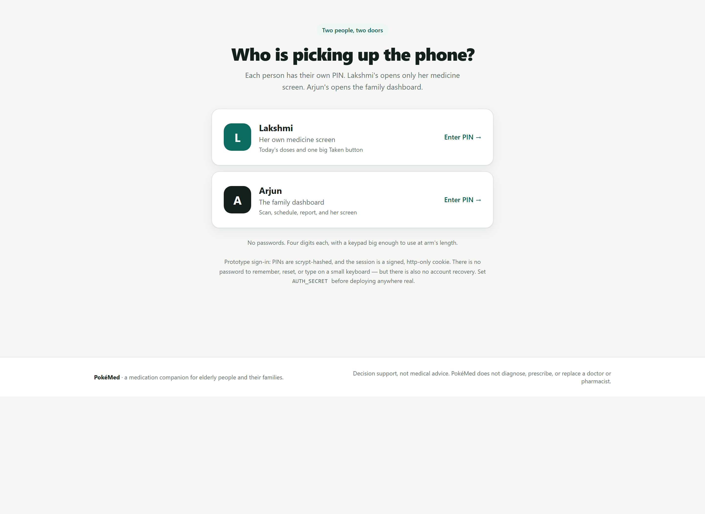
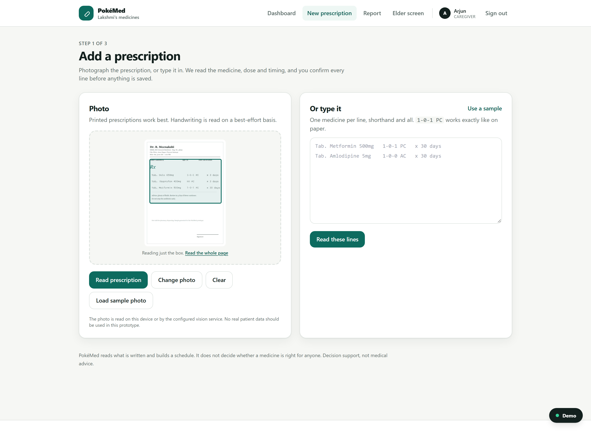

# PokéMed

**A medication companion for elderly people and their families.**

> Love shouldn't depend on a phone call asking "did you take your medicine?"

Older adults forget doses or misread prescriptions, and the family living far away has no way to know whether the
medicines were actually taken. The result is missed treatment and avoidable hospital visits.

PokéMed closes that loop: the caregiver scans the prescription, the elder gets one enormous **Taken** button, and the
family sees what happened — including the doses that were missed.

**Decision support, not medical advice.** PokéMed does not diagnose, prescribe, or replace a doctor or pharmacist.

---

## What it does

1. **Scan a prescription.** Photograph the page, drag a box around the medicine lines, and browser OCR reads just
   that box. A vision model is used instead when `OPENAI_API_KEY` is set. The doctor's shorthand is then decoded —
   `1-0-1`, `BD`, `TDS`, `HS`, `SOS`, `PC`, `AC`, `7 AM`, `8hrly`, `x 30 days`, `½`.
2. **The caregiver confirms.** Every extracted line is editable. Nothing is scheduled until a human says it is right.
   Hospital-only lines (IV/IM/injections) and supplies are reported separately and never put on a home schedule.
3. **A schedule is built.** Times are grouped into Morning / Afternoon / Night, with food instructions and course
   length. `SOS` medicines stay as-needed and never get a fixed slot.
4. **The elder gets one screen.** Huge text, a spoken reminder, and one big **Taken** button. Tamil and Hindi
   interfaces are included, with voice where the device has the voice installed.
5. **Every dose is logged** as taken or missed, with a timestamp and who confirmed it.
6. **Missed doses reach the caregiver.** After a 60-minute grace period the dose becomes missed and an alert appears
   on the caregiver dashboard.
7. **A weekly report** shows percent taken, a day-by-day grid, and every missed dose with its time.
8. **Conflicts are flagged for a pharmacist** — duplicate active ingredients across brand names, therapeutic
   duplication, and a short curated list of risky pairs, each with a named source.

---

## Screens

| Caregiver dashboard | Elder screen |
|---|---|
|  |  |

| Two doors: one PIN each | Confirming the prescription |
|---|---|
|  |  |

| Crop to the medicine lines |
|---|
|  |

| Missed-dose alert |
|---|
|  |

---

## Run it

```bash
npm install
npm run seed     # a synthetic elder, caregiver and a realistic week of history
npm run dev      # http://localhost:3000
```

Sign in with a PIN — no email, no password to type on a phone:

| Who | PIN | Sees |
|---|---|---|
| Lakshmi (elder) | `1234` | Her own screen only: today's doses and the **Taken** button |
| Arjun (caregiver) | `2468` | Everything: scan, schedule, report, flags, and a preview of her screen |

The two PINs are separate doors. Lakshmi's session is confined to `/elder`, `/api/state` and `/api/doses`; anything
else redirects or returns 403. Arjun's session can reach the whole app. PINs are scrypt-hashed in the data file, and
the session is an HMAC-signed, http-only cookie (seven days). This is prototype auth: the demo PINs are printed on the
sign-in screen, and there is no account recovery.

Optional environment (see `.env.example`):

- `OPENAI_API_KEY` — reads prescription photos with a vision model.
- Without it, photos are read in the browser with Tesseract.js, or you can paste prescription text.
- `AUTH_SECRET` — signs the session cookie. A demo fallback is built in; set a long random value before deploying
  anywhere real.

Useful scripts:

```bash
npm test         # 22 checks: shorthand decoder, prescription parsing, safety rules
npm run build    # production build
npm run ocr:bench -- "priscrip'"   # local OCR benchmark; writes only to data/ocr-bench/
npm run ocr:lab -- "priscrip'"     # compare segmentation and preprocessing options
```

The **Demo** button in the bottom-right corner moves the clock (jump to the next dose, skip to the next missed dose), resets
the seven-day history, and returns to real time. It is not part of the product.

For a fully offline demo: **New prescription → Use a sample → Read these lines**. No external service is involved.
For the photo path, **Load sample photo → Read prescription** runs real OCR in the browser. Dragging a box around the
medicine lines before reading is the single biggest accuracy win on a phone photo.

---

## The reader, honestly

The reader has two jobs, and only the second one is allowed to make decisions:

1. **Read** the page into text — a vision model if configured, otherwise Tesseract.js in the browser.
2. **Decode** that text with deterministic rules, unit-tested in `npm test`.

A local benchmark (`scripts/ocr-bench.mjs`) runs the real upload screen on four real WhatsApp prescription photos.
The result on this build is **0 of 4 photos yielded a medicine line** with browser OCR alone. The photos are
387–1019 px, and two are handwriting; Tesseract does not read cursive. Cropping, upscaling and a grayscale contrast
stretch make the text visibly better (`scripts/ocr-lab.mjs`), but not into a dose anyone should trust.

The printed sample that ships with the demo parses **3 of 3** medicines, and that is the honest boundary: clean print
works, handwriting needs a vision model. The app does not pretend otherwise — when OCR finds nothing it keeps the text
on screen, says why, and asks you to type the lines. Every line still needs a human confirmation.

The benchmark and lab write only to `data/ocr-bench/` and `data/ocr-lab/`, both git-ignored. The photos themselves are
never uploaded by these scripts and are not in the repository.

---

## How it works

```
Next.js (App Router) + TypeScript + Tailwind
├── app/            caregiver dashboard, scan, review, schedule, report, elder screen, flags
├── components/     elder dose card, status pills, demo panel
├── lib/
│   ├── parse/      doctor-shorthand decoder (deterministic rules)
│   ├── checks.ts   duplicate salt, therapeutic duplication, curated risky pairs
│   ├── state.ts    sweep for missed doses + build the dashboard view
│   ├── db.ts       file-backed store (data/db.json)
│   └── data/       brand→salt map, interaction list with sources
└── data/           seeded database
```

**The model reads; the rules decide.** A vision model (or browser OCR) produces text. A deterministic parser turns
that text into times, and every rule has a unit test. No model is ever asked to invent a dose or a schedule — the
schedule is reproducible and explainable.

**One clock.** Every read of "now" goes through `lib/clock.ts`. The demo panel shifts it, and the missed-dose sweep
runs on each state read, so there is no cron job and nothing to wait for on stage.

**Two doors, one app.** `middleware.ts` checks a signed session on every page and API call. An elder session can only
reach `/elder` and her two endpoints; a caregiver session can reach everything. The PIN is the whole login — one big
keypad, four digits, no keyboard — because the person using it may be 72 and holding the phone at arm's length.

**Safety checks compare active ingredients, not names.** `Crocin` and `Dolo` are both paracetamol, and that is
exactly the mistake families make. The brand→salt map is deliberately small and curated.

---

## What is real, and what is not

| Real | Mocked or limited |
|---|---|
| Shorthand decoding, schedule generation, dose logging | A single elder and caregiver in the seeded data |
| Separate elder and caregiver PIN sign-in | Prototype auth: demo PINs shown on screen, no recovery or lockout policy |
| Missed-dose detection and alerts | Alert is on the caregiver dashboard; email/push not wired by default |
| Duplicate-salt and curated pair checks | Short curated list, not a full interaction database |
| Seven-day adherence maths | History is seeded so the report is meaningful in a demo |
| Printed-prescription OCR | Handwriting is best-effort — which is why every line is confirmed |
| Tamil/Hindi interface strings | Voice depends on the device having that voice installed |

"Send to pharmacist" records a review request. No pharmacist is connected in this prototype.

All data is synthetic. Do not enter real patient information.

---

## The demo, in one minute

0. Sign in as Arjun with PIN `2468`. (If asked: Lakshmi's door is PIN `1234`, and it opens her screen only.)
1. Caregiver scans a prescription; the shorthand is decoded on screen; one field is corrected.
2. The schedule appears for today.
3. Demo → *Jump to the next dose*, then open the elder screen. It speaks the dose; **Taken** is pressed.
4. The caregiver dashboard turns green in the same second.
5. Demo → *Skip to next missed dose* → the alert appears.
6. The report shows the week.
7. A flag opens: two medicines, same active ingredient, with the source named.

Closing line: **"They took care of us for a lifetime. Let's take care of their medicines."**

---

## Next

- Push notifications and a real pharmacist review queue
- A verified drug database and interaction service instead of a curated list
- Multi-elder households and caregiver handover
- Offline-first elder app for low-connectivity homes
- Refill reminders and pharmacy integration
